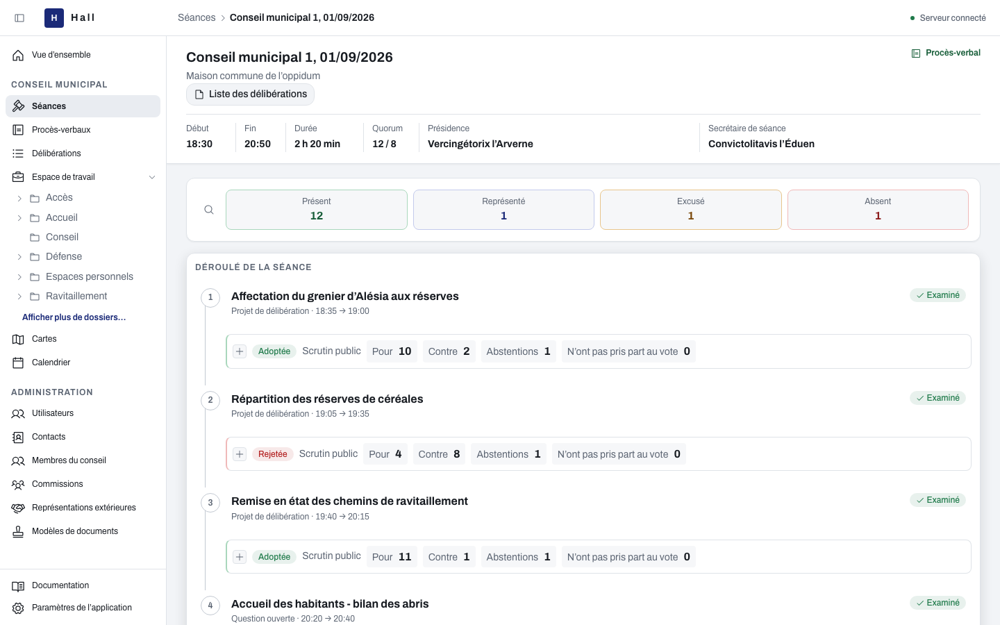

# Hall

**Prepare council business, conduct meetings and keep the resulting records.**

Hall is an application for French municipal councils. It connects the working documents, people, agenda, votes and records of a council, from preparing an item to preserving its decisions and minutes. The application and its user guide are in French.

**[Discover Hall](https://ng-galien.github.io/hall/) · [Read the user guide](https://ng-galien.github.io/hall/documentation/index.html#/docs) · [Versions and downloads](https://github.com/ng-galien/hall/releases)**

*The Alésia demonstration: agenda items, attendance, quorum and ballot results in one meeting view.*

## From preparation to the council record

| Work | In Hall |
| --- | --- |
| Prepare council business | Organize matters and supporting documents; work with text, files, spreadsheets and maps; prepare agenda items and invitations. |
| Conduct a meeting | Follow attendance, proxies and quorum; work through the agenda; record public or secret ballots and decisions. |
| Keep the record | Produce decisions, minutes and PDF documents, keeping frozen documents separate from later edits to their templates. |
| Configure the application | Manage council members, committees and contacts; adapt document templates, application settings and account permissions. |

The [public site](https://ng-galien.github.io/hall/) shows these workflows with application screenshots. The [user guide](https://ng-galien.github.io/hall/documentation/index.html#/docs) explains how to use them.

## Try Hall with Alésia

The desktop demonstration runs on your computer with a fictional municipality, Alésia. It opens with a demonstration account and prepared data: council members, committees, contacts, council business, meetings, ballots and documents. There is no account to create or password to enter. Its embedded database is stored locally; the **Démonstration** menu resets the demonstration data.

**Public release 1.0.0 is being prepared. No public installer is available until a release is published.** Downloads will appear on the [versions page](https://github.com/ng-galien/hall/releases), with the available platforms and installation notes. The macOS Apple silicon demonstration has been checked locally; other desktop platforms have not yet been validated on hardware.

Once a build is available:

1. Choose the installer for your system from its release page.
2. Follow the [demonstration installation guide](docs/distribution.md#installer-la-démonstration). The installers do not have an Apple or Microsoft publisher signature; the guide explains the first-launch notices.
3. Open Hall, let it prepare the demonstration, then choose **Ouvrir Hall**. Explore the dataset and reset it when needed.

The demonstration is for exploring Hall with fictional data. For a shared Hall server, installation, configuration and recovery are documented in the [deployment guide](docs/distribution.md).

## Connect an AI assistant

Hall exposes tools through **MCP** so an external AI assistant can search and read workspace resources, prepare text and files, create council business, and work with document templates and settings allowed by the connected account.

The assistant can discover Hall's tools through `hall_learn`, a guide included with Hall. Its actions follow the permissions and operations exposed by the server. Council decisions and human validations remain with the people using Hall; the current MCP tools do not conduct meetings or record votes.

Read [Connecter un agent IA par MCP](https://ng-galien.github.io/hall/documentation/index.html#/docs/assistant-ia) for the supported capabilities, installation and authentication. An external MCP client is required; Hall does not include an AI provider or a chat interface.

## Documentation and development

- **Using Hall:** [French user guide](https://ng-galien.github.io/hall/documentation/index.html#/docs).
- **Installing and operating Hall:** [distribution](docs/distribution.md) and [local runtimes](docs/runtime.md).
- **Understanding the project:** [documentation map](docs/README.md), [architecture](docs/project.md) and [application configuration](docs/configuration.md).
- **Developing and verifying changes:** [development guide](docs/development.md), [behavior requirements](requirements/README.md) and [repository instructions](AGENTS.md).

The source repository is an npm workspace. Technical setup, PostgreSQL operation, verification commands and packaging instructions live in the linked documentation.

## Licence

Hall is distributed under the **European Union Public Licence, version 1.2 (EUPL-1.2)**. The copyright holder is Alexandre Boyer. Read the [full licence](LICENSE).
