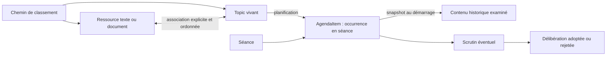
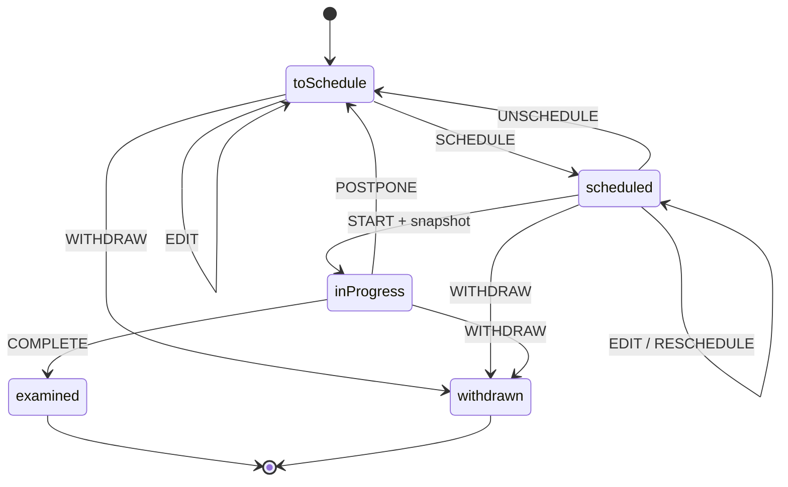

# Design point Mardang

> Boussole fonctionnelle et technique du produit Hall — 28 août 2026.

Ce document fixe les décisions validées pendant la reprise du modèle. Il sert à orienter le backend et la future IHM, et à reconnaître les concepts devenus legacy. Il ne redessine pas le mode de conduite de séance, qui est conservé.

## Deux axes d’usage

### Travail quotidien

L’utilisateur navigue dans des chemins de classement, rédige des textes, ajoute des documents, prépare des Topics et constitue progressivement le prochain ordre du jour.

Le frontend doit pouvoir composer cet espace sans reproduire les objets SQL ni imposer une navigation multipage. Le backend expose donc des chemins, des ressources, leurs Topics associés et l’historique des occurrences de chaque Topic.

### Activité normative du conseil

La séance rassemble un ordre du jour ordonné, les présences et pouvoirs, le quorum, les points examinés, les scrutins et les délibérations. Le mode de conduite existant reste autonome et n’est pas redessiné.

Après clôture, la séance est l’entrée documentaire permettant de retrouver exactement les points présentés, les pièces consultées, les discussions, les votes et les décisions.

## Modèle validé

### Chemins et ressources

- Un dossier n’est pas une entité métier : c’est un `folderPath` normalisé, séparé par `/`.
- Une `Resource` est une union `text | document`.
- Toutes les ressources portent des tags recherchables.
- Un chemin sert à classer et à proposer en priorité les ressources proches ; il ne crée jamais une association implicite.
- Un Topic référence explicitement ses ressources, dans l’ordre prévu pour la présentation. Il peut également utiliser des ressources provenant d’autres chemins.

### Topic vivant

Le Topic représente le point en préparation. Son type algébrique décrit ce qu’il est :

- `subject` : sujet informatif ou associé à un projet de délibération ;
- `minutesApproval` : approbation du procès-verbal d’une séance ;
- `openQuestion` : question ouverte autonome, jamais soumise au vote.

Il porte un intitulé d’ordre du jour (`title`), un texte préparatoire (`report`), un chemin de travail et ses ressources ordonnées. Une délibération reste facultative pour un `subject`.

## Cycle du Topic

La machine XState du domaine est l’unique arbitre de ce cycle. Les commandes serveur valident la transition puis modifient le Topic, l’AgendaItem, le scrutin et la délibération dans la même unité de travail.

- Le contenu et les pièces du Topic sont modifiables en `toSchedule` et `scheduled`.
- Son classement reste modifiable après examen ; ce reclassement ne réécrit jamais le snapshot historique ni le texte voté.
- `START` verrouille le Topic et photographie dans l’AgendaItem son type, son intitulé, son rapport, son chemin, sa décision éventuelle et ses ressources ordonnées.
- `POSTPONE` conserve l’occurrence historique et remet le Topic en préparation.
- `COMPLETE` termine définitivement le Topic en `examined`.
- Après un vote définitif, une nouvelle présentation du même thème requiert un nouveau Topic et une nouvelle délibération. Un Topic ne devient pas un dossier thématique permanent.

## Occurrence et historique

L’`AgendaItem` est le passage d’un Topic dans une séance. Il est distinct du Topic vivant.

Avant son démarrage, il présente les données courantes du Topic. Au démarrage, lors de la fermeture d’un point resté ouvert ou dès le constat d’un défaut de quorum, il conserve un snapshot. Le Topic, sa délibération et le contenu de ses ressources sont alors figés pour cette occurrence, y compris en seconde convocation ; seul leur classement reste modifiable. Une modification ultérieure d’un Topic reporté ne change donc jamais une séance passée.

L’historique d’un point comprend :

- la séance et la position dans l’ordre du jour ;
- le contenu et les ressources réellement présentés ;
- la synthèse de discussion ;
- le résultat `examined`, `postponed` ou `withdrawn` ;
- le scrutin et la délibération éventuels.

La liste des points votés n’est pas une nouvelle entité. Elle se déduit des AgendaItems d’une séance possédant un scrutin.

## Contrats de navigation backend

Le backend expose `application/vnd.siren+json`. Chaque réponse porte ses liens et uniquement les actions actuellement
autorisées par le rôle de l’utilisateur **et** l’état métier. Le frontend suit ces affordances ; il ne recalcule ni les
permissions ni les transitions. Le package `@hall/api-contract` partage les types Siren, les noms d’actions, les rôles
et le décodage entre serveur et client, sans importer le domaine ni un adaptateur d’exécution.

Un lien `self` désigne toujours la ressource consultée par une route `GET` et conserve les filtres d’une collection, y compris pour un utilisateur, un membre, une présence,
un point d’ordre du jour ou un scrutin. Les mutations du client partent des actions Siren mises en cache lors de la
lecture ; si une action n’est pas annoncée, elle n’est pas tentée. Cela vaut également pour l’upload multipart.
Le lien `content` d’une ressource documentaire est également fourni par Siren : le client ne reconstruit pas sa route.

Les erreurs utilisent `application/problem+json` (RFC 9457) avec un `code` métier stable et un identifiant de requête.
Les principales navigations restent :

- chemins disponibles : `GET /api/resources/paths` ;
- ressources d’un chemin ou de tags : `GET /api/resources` ;
- ressource et Topics associés : `GET /api/resources/:resourceId` ;
- Topics filtrés par état, chemin ou ressource : `GET /api/topics` ;
- Topic, décision et occurrences de séance : `GET /api/topics/:topicId` ;
- séance normative complète : `GET /api/council-meetings/:meetingId` ;
- délibération adressable : `GET /api/council-decisions/:decisionId`.

Ces contrats permettent deux points d’entrée IHM sans créer deux modèles concurrents : l’espace de travail quotidien et la séance normative.

## Utilisateurs, droits et preuve

Un `User` est une identité applicative ; il peut être rattaché à zéro ou un `CouncilMember`. Ce sont deux notions
distinctes : un agent municipal peut utiliser le logiciel sans mandat, et un élu peut exister sans compte.

Le contrôle d’accès reste volontairement simple : RBAC pour les droits larges, puis projection contextuelle des actions
Siren à partir des machines d’état. Les rôles initiaux sont `administrator`, `clerk`, `contributor`,
`meetingConductor` et `reader`. Il n’y a pas de moteur ABAC générique ni de règles dupliquées dans React.

Les sessions utilisent un cookie `HttpOnly` et les mots de passe sont dérivés avec `scrypt`. Chaque écriture réussie
produit dans la même transaction un événement d’audit contenant acteur, action, cible, date et identifiant de requête.
Les changements de présence et de rôles y ajoutent les valeurs métier utiles à l’explication de l’événement.
Le dernier administrateur actif ne peut pas être désactivé ni perdre son rôle.

Le cookie est `SameSite=Strict`, les mutations provenant d’une autre origine sont refusées sauf origine explicitement
autorisée. Le proxy Vite local est autorisé uniquement en développement. Les échecs répétés de
connexion sont limités. La vérification de mot de passe effectue le même travail cryptographique pour une adresse
connue ou inconnue. Les mutations refusées ou échouées sont auditées hors de la transaction annulée avec les issues
`denied` ou `failed`. Le bootstrap crée le premier administrateur et ouvre immédiatement sa session ; l’IHM fournit donc
un passage de bootstrap ou de connexion utilisable aussi bien avec le serveur partagé qu’avec Electron. Hors boucle
locale, son jeton d’initialisation explicite est obligatoire.

En développement uniquement, `npm run dev` active automatiquement un administrateur local doté de tous les droits.
Le serveur refuse ce mode hors boucle locale ou avec `NODE_ENV=production`. Le seed crée en plus un utilisateur de
chaque rôle, avec des rattachements représentatifs aux membres du conseil.

## Invariants backend

- Le serveur possède seul la base ; les clients passent par HTTP. Awilix injecte un exécuteur commun choisi au démarrage par `DATABASE_KIND=sqlite|postgres`.
- SQLite reste le moteur embarqué et conserve son schéma `STRICT`, ses contrôles et ses fichiers WAL/SHM privés. PostgreSQL possède un schéma explicite avec ses types natifs (`BOOLEAN`, `JSONB`, `BYTEA`).
- Les repositories utilisent exclusivement un catalogue central de requêtes nommées à paramètres. Une requête commune est la règle ; une variante SQLite ou PostgreSQL n’existe que lorsqu’un dialecte le demande.
- Une transaction PostgreSQL conserve le même `PoolClient`, s’exécute en isolation `SERIALIZABLE` et rejoue de façon bornée les seuls conflits de sérialisation. Aucun driver brut ni SQL ad hoc ne remonte dans les services métier.
- Les cycles de séance, Topic, délibération et scrutin sont centralisés dans les machines du domaine, jamais réécrits dans le frontend.
- Les associations Topic–ressource et les snapshots sont ordonnés et persistés côté serveur.
- Une ressource liée à un Topic ou à une occurrence historique ne peut pas être supprimée.
- Le snapshot conserve des références vers les ressources ; leur contenu n’est pas dupliqué.
- Le quorum, les votants, les déports, pouvoirs et règles de majorité restent validés par le backend avant enregistrement du scrutin.
- Un même porteur ne reçoit qu’un pouvoir par séance et une même pièce écrite de pouvoir ne peut justifier deux représentations.
- Les écritures coordonnées utilisent une unité de travail transactionnelle, y compris la vérification puis la mutation d’une délibération encore modifiable.
- Les autorisations et actions Siren sont décidées par le serveur ; leur catalogue n’est pas une politique frontend.
- L’identité applicative, le rattachement éventuel à un élu et l’auteur des mutations restent consultables séparément.
- Pendant une séance ouverte, la conduite peut créer et inscrire atomiquement en fin d’ordre du jour une question ouverte ou un `subject` informatif sans délibération. L’AgendaItem porte `addedDuringSession` ; ce point tardif ne peut recevoir ni délibération ni scrutin. La conduite ne reçoit pas pour autant les droits généraux de préparation.

Le premier périmètre enregistre le pouvoir au niveau d’une séance. Remplacer une présence `represented` par une autre
situation révoque donc ce pouvoir pour la séance et laisse une trace d’audit. Le produit n’essaie pas encore de déduire
qu’une même procuration couvre plusieurs séances consécutives : ce futur besoin exige une entité de mandat propre et la
prise en compte des exceptions légales, plutôt qu’un compteur implicite sur les présences. La limite légale actuellement
en vigueur est de trois séances consécutives hors exceptions prévues par le CGCT L2121-20 ; elle devra être revérifiée
avant cette extension.

## Concepts legacy à refuser

| Concept | Décision validée |
|---|---|
| `CaseFile` avec identité et cycle de vie | Supprimé. Le dossier est un chemin de classement. |
| Une délibération obligatoirement créée depuis un dossier | Supprimé. Un Topic peut être informatif ou porter une délibération. |
| Toutes les ressources présentes dans un chemin automatiquement liées | Refusé. Le chemin suggère ; les associations sont explicites. |
| Un Topic consommé et écrasé par sa séance | Refusé. L’AgendaItem conserve chaque occurrence historique. |
| Un même Topic réutilisé après plusieurs votes définitifs | Refusé. Après vote, une nouvelle soumission crée un nouveau Topic. |
| État final `discussed` | Remplacé par `examined`, qui couvre discussion et vote. |
| Logique de transition dupliquée dans l’IHM | Refusée. Les commandes passent par les machines serveur. |
| Adaptateurs, routes ou migrations de compatibilité | Refusés pendant la construction du produit ; la base de développement est réinitialisée. |
| Jeton administrateur global conservé dans le navigateur | Supprimé. Les accès passent par des utilisateurs et des sessions individuelles. |
| Matrice de rôles ou transitions réécrite dans React | Refusée. Le client consomme les actions Siren annoncées par le serveur. |

## Direction ergonomique

L’IHM future doit privilégier une navigation continue : explorer un chemin, ouvrir une ressource, voir ses Topics, préparer un point, consulter ses occurrences puis rejoindre la séance correspondante. Le contexte doit rester visible ; les objets ne doivent pas être transformés en succession de formulaires et de pages indépendantes.

Le mode séance conserve son espace plein écran et son workflow actuel. Son évolution consiste à lui fournir les ressources du snapshot et l’historique validé, pas à reconstruire sa conduite.

En cas de défaut de quorum, la seconde convocation conserve la date d’envoi de sa convocation et ne peut être créée que si trois jours francs complets séparent cet envoi de la nouvelle réunion. L’ordre du jour et les preuves de la première occurrence restent figés.

La publication des ressources associées reste hors de ce design. Leur association garantit leur consultation en préparation et en séance, sans décider de leur diffusion publique.
