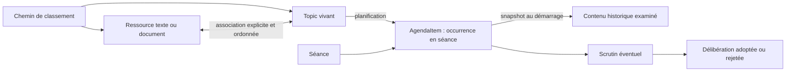
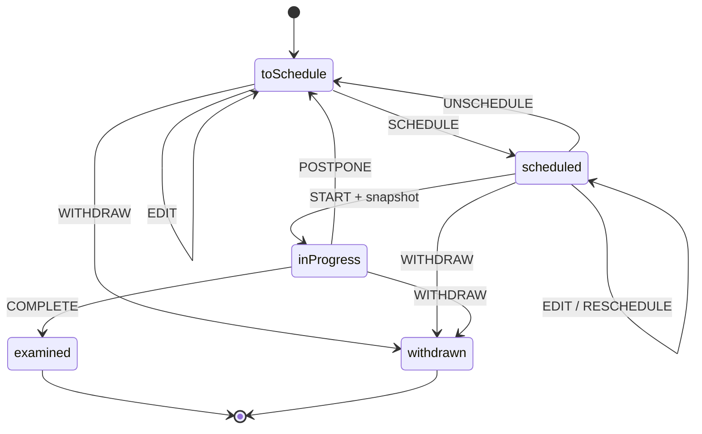

# Design point Mardang

> Boussole fonctionnelle et technique du produit Mairie — 27 août 2026.

Ce document fixe les décisions validées pendant la reprise du modèle. Il sert à orienter le backend et la future IHM, et à reconnaître les concepts devenus legacy. Il ne redessine pas le mode de conduite de séance, qui est conservé.

## Deux axes d’usage

### Travail quotidien

L’utilisateur navigue dans des chemins de classement, rédige des textes, ajoute des documents, prépare des Topics et constitue progressivement le prochain ordre du jour.

Le frontend doit pouvoir composer cet espace sans reproduire les objets SQL ni imposer une navigation multipage. Le backend expose donc des chemins, des ressources, leurs Topics associés et l’historique des occurrences de chaque Topic.

### Activité normative du conseil

La séance rassemble un ordre du jour ordonné, les présences et pouvoirs, le quorum, les points examinés, les scrutins et les délibérations. Le mode de conduite existant reste autonome et n’est pas redessiné.

Après clôture, la séance est l’entrée documentaire permettant de retrouver exactement les points présentés, les pièces consultées, les discussions, les votes et les décisions.

## Modèle validé

### Chemins et ressources

- Un dossier n’est pas une entité métier : c’est un `folderPath` normalisé, séparé par `/`.
- Une `Resource` est une union `text | document`.
- Toutes les ressources portent des tags recherchables.
- Un chemin sert à classer et à proposer en priorité les ressources proches ; il ne crée jamais une association implicite.
- Un Topic référence explicitement ses ressources, dans l’ordre prévu pour la présentation. Il peut également utiliser des ressources provenant d’autres chemins.

### Topic vivant

Le Topic représente le point en préparation. Son type algébrique décrit ce qu’il est :

- `subject` : sujet informatif ou associé à un projet de délibération ;
- `minutesApproval` : approbation du procès-verbal d’une séance ;
- `openQuestion` : question ouverte autonome, sans vote obligatoire.

Il porte un intitulé d’ordre du jour (`title`), un texte préparatoire (`report`), un chemin de travail et ses ressources ordonnées. Une délibération reste facultative pour un `subject`.

## Cycle du Topic

La machine XState du domaine est l’unique arbitre de ce cycle. Les commandes serveur valident la transition puis modifient le Topic, l’AgendaItem, le scrutin et la délibération dans la même unité de travail.

- Le Topic est modifiable en `toSchedule` et `scheduled`.
- `START` verrouille le Topic et photographie dans l’AgendaItem son type, son intitulé, son rapport, son chemin, sa décision éventuelle et ses ressources ordonnées.
- `POSTPONE` conserve l’occurrence historique et remet le Topic en préparation.
- `COMPLETE` termine définitivement le Topic en `examined`.
- Après un vote définitif, une nouvelle présentation du même thème requiert un nouveau Topic et une nouvelle délibération. Un Topic ne devient pas un dossier thématique permanent.

## Occurrence et historique

L’`AgendaItem` est le passage d’un Topic dans une séance. Il est distinct du Topic vivant.

Avant son démarrage, il présente les données courantes du Topic. Au démarrage — ou lors de la fermeture d’un point resté ouvert — il conserve un snapshot. Une modification ultérieure du Topic reporté ne change donc jamais une séance passée.

L’historique d’un point comprend :

- la séance et la position dans l’ordre du jour ;
- le contenu et les ressources réellement présentés ;
- la synthèse de discussion ;
- le résultat `examined`, `postponed` ou `withdrawn` ;
- le scrutin et la délibération éventuels.

La liste des points votés n’est pas une nouvelle entité. Elle se déduit des AgendaItems d’une séance possédant un scrutin.

## Contrats de navigation backend

Le backend fournit des liens navigables et laisse le frontend orchestrer les panneaux et parcours :

- chemins disponibles : `GET /api/resources/paths` ;
- ressources d’un chemin ou de tags : `GET /api/resources` ;
- ressource et Topics associés : `GET /api/resources/:resourceId` ;
- Topics filtrés par état, chemin ou ressource : `GET /api/topics` ;
- Topic, décision et occurrences de séance : `GET /api/topics/:topicId` ;
- séance normative complète : `GET /api/council-meetings/:meetingId` ;
- délibération adressable : `GET /api/council-decisions/:decisionId`.

Ces contrats permettent deux points d’entrée IHM sans créer deux modèles concurrents : l’espace de travail quotidien et la séance normative.

## Invariants backend

- Le serveur possède seul SQLite ; les clients passent par HTTP.
- Les cycles de séance, Topic, délibération et scrutin sont centralisés dans les machines du domaine, jamais réécrits dans le frontend.
- Les associations Topic–ressource et les snapshots sont ordonnés et persistés côté serveur.
- Une ressource liée à un Topic ou à une occurrence historique ne peut pas être supprimée.
- Le snapshot conserve des références vers les ressources ; leur contenu n’est pas dupliqué.
- Le quorum, les votants, les déports, pouvoirs et règles de majorité restent validés par le backend avant enregistrement du scrutin.
- Les écritures coordonnées utilisent une unité de travail transactionnelle.

## Concepts legacy à refuser

| Concept | Décision validée |
|---|---|
| `CaseFile` avec identité et cycle de vie | Supprimé. Le dossier est un chemin de classement. |
| Une délibération obligatoirement créée depuis un dossier | Supprimé. Un Topic peut être informatif ou porter une délibération. |
| Toutes les ressources présentes dans un chemin automatiquement liées | Refusé. Le chemin suggère ; les associations sont explicites. |
| Un Topic consommé et écrasé par sa séance | Refusé. L’AgendaItem conserve chaque occurrence historique. |
| Un même Topic réutilisé après plusieurs votes définitifs | Refusé. Après vote, une nouvelle soumission crée un nouveau Topic. |
| État final `discussed` | Remplacé par `examined`, qui couvre discussion et vote. |
| Logique de transition dupliquée dans l’IHM | Refusée. Les commandes passent par les machines serveur. |
| Adaptateurs, routes ou migrations de compatibilité | Refusés pendant la construction du produit ; la base de développement est réinitialisée. |

## Direction ergonomique

L’IHM future doit privilégier une navigation continue : explorer un chemin, ouvrir une ressource, voir ses Topics, préparer un point, consulter ses occurrences puis rejoindre la séance correspondante. Le contexte doit rester visible ; les objets ne doivent pas être transformés en succession de formulaires et de pages indépendantes.

Le mode séance conserve son espace plein écran et son workflow actuel. Son évolution consiste à lui fournir les ressources du snapshot et l’historique validé, pas à reconstruire sa conduite.

La publication des ressources associées reste hors de ce design. Leur association garantit leur consultation en préparation et en séance, sans décider de leur diffusion publique.
